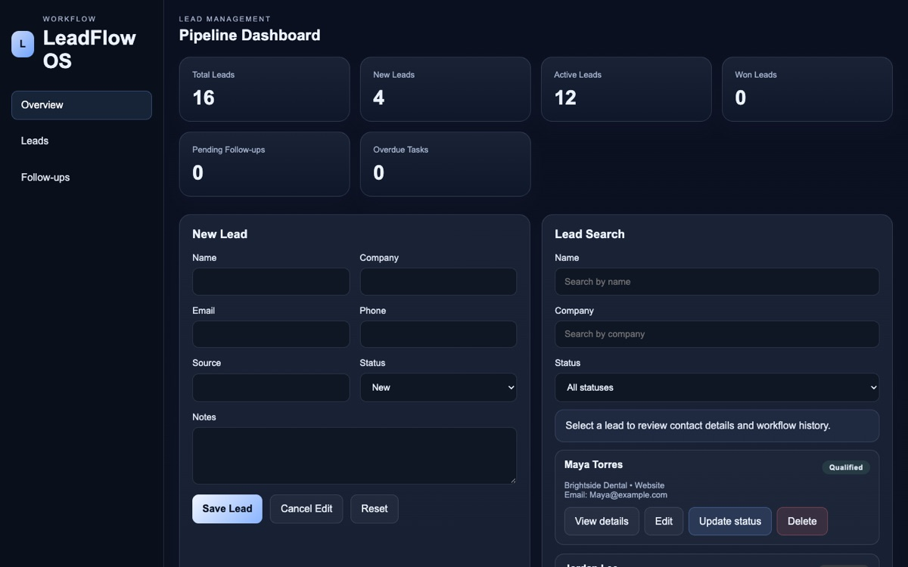
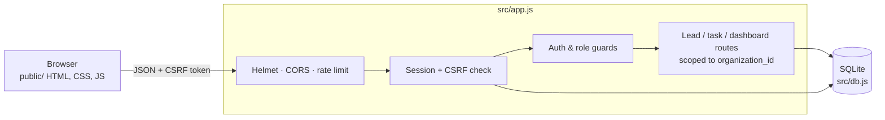

# LeadFlow OS

**A multi-tenant CRM for tracking leads and follow-ups, built with Node.js, Express and SQLite.**

[](https://github.com/kennycharlesdev/leadflow-os/actions/workflows/ci.yml)




Small service businesses lose leads because follow-ups live in notebooks, texts and memory. LeadFlow OS gives each
business its own workspace with a pipeline dashboard, lead records and follow-up tasks, and keeps every
organization's data strictly separated from the others.

> **Status:** working MVP in active development. It runs locally with fictional demo data and is not yet intended for
> real customer data. See [docs/NEXT_STEPS.md](docs/NEXT_STEPS.md) for the roadmap.

## Highlights

- **Multi-tenant by design.** Every lead, task and admin query is scoped to the signed-in user's organization. A test
  proves one organization cannot read another's leads.
- **Real authentication.** Registration and login with bcrypt-hashed passwords, server-side sessions stored in SQLite,
  and role checks for admin-only endpoints.
- **CSRF protection.** Every authenticated, state-changing request needs a per-session CSRF token.
- **Hardened HTTP layer.** Helmet security headers, a CORS allowlist, and rate limiting on the API and auth routes.
- **Validated input.** Lead and task payloads are checked server-side (required fields, status values, email and phone
  formats), and all SQL is parameterized.
- **Tested.** 10 API tests cover auth, CSRF, validation, filtering and organization isolation, and run in CI on every push
  alongside a secret scan.
- **No framework on the front end.** The dashboard is vanilla HTML, CSS and JavaScript calling a JSON API.

## Tech stack

| Layer    | Tools                                                        |
| -------- | ------------------------------------------------------------ |
| Server   | Node.js, Express 4                                           |
| Data     | SQLite (`sqlite3`), versioned schema migrations              |
| Security | bcryptjs, express-session, Helmet, CORS, express-rate-limit  |
| Frontend | Vanilla HTML, CSS, JavaScript                                |
| Testing  | Node's built-in test runner, Supertest                       |
| CI       | GitHub Actions (tests + gitleaks secret scan)                |

## Architecture



- `server.js` starts the server.
- `src/app.js` holds the middleware, validation and API routes.
- `src/db.js` owns the schema, migrations, demo seed data and all queries.
- `public/` is the single-page dashboard.
- `tests/api.test.js` contains the API tests.

More detail in [docs/ARCHITECTURE.md](docs/ARCHITECTURE.md) and [docs/SECURITY_REVIEW.md](docs/SECURITY_REVIEW.md).

## Quick start

Requires Node.js 20 or newer.

```bash
git clone https://github.com/kennycharlesdev/leadflow-os.git
cd leadflow-os
npm install
cp .env.example .env        # then set SESSION_SECRET to a long random string
npm start
```

Open http://localhost:3000, create an account, and start adding leads. Each new account gets its own organization.

```bash
npm run dev     # restart on file changes
npm test        # run the API test suite
npm run check   # syntax-check the server code
```

## API

All routes except health, CSRF token, register and login require a signed-in session. State-changing requests also need
the `X-CSRF-Token` header from `GET /api/csrf-token`.

| Method | Route                       | Purpose                                     |
| ------ | --------------------------- | ------------------------------------------- |
| GET    | `/api/health`               | Health check                                |
| GET    | `/api/csrf-token`           | Get the session's CSRF token                |
| POST   | `/api/auth/register`        | Create an account and organization          |
| POST   | `/api/auth/login`           | Sign in                                     |
| POST   | `/api/auth/logout`          | Sign out                                    |
| GET    | `/api/auth/me`              | Current user                                |
| GET    | `/api/dashboard`            | Lead and task metrics for the organization  |
| GET    | `/api/leads`                | List leads (filter by name, company, status)|
| POST   | `/api/leads`                | Create a lead                               |
| GET    | `/api/leads/:id`            | Get one lead                                |
| PUT    | `/api/leads/:id`            | Update a lead                               |
| DELETE | `/api/leads/:id`            | Delete a lead and its tasks                 |
| GET    | `/api/tasks`                | List follow-up tasks                        |
| POST   | `/api/tasks`                | Create a task for a lead                    |
| PUT    | `/api/tasks/:id`            | Update or complete a task                   |
| DELETE | `/api/tasks/:id`            | Delete a task                               |
| GET    | `/api/admin/users`          | Organization members (admin/owner only)     |
| GET    | `/api/admin/workflow-events`| Organization activity log (admin/owner only)|

## Data model

- **organizations**: one per workspace
- **users**: name, email, bcrypt hash, role (`owner`, `admin`, `member`), organization
- **leads**: name, company, email, phone, source, status (`New`, `Contacted`, `Qualified`, `Won`, `Lost`), notes
- **tasks**: follow-ups linked to a lead, with due date and completion
- **workflow_events**: an activity log foundation (registrations, changes)
- **sessions**: server-side session store

## What I'd build next

- Due-date reminders and an overdue-task view
- Lead import from CSV
- Invite teammates into an existing organization
- Deploy behind HTTPS with a managed database

## About

Built by **Kiny St Charles**: [portfolio](https://kennycharlesdev.github.io/my-portfolio/) ·
[GitHub](https://github.com/kennycharlesdev)

Licensed under the [MIT License](LICENSE).
